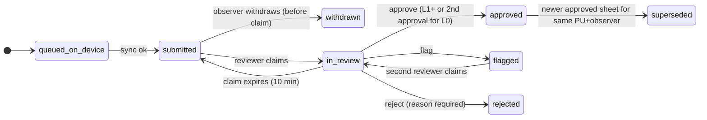
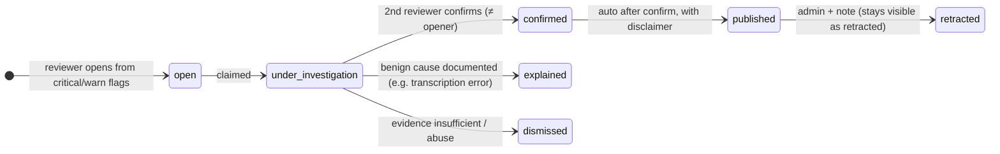

# OpenCivic NG — Flagship Spec: "Sheet Match"

Status: build spec v1 · Owner: Obaro Destiny Udurie · Base: `opencivic-ng` MVP (TypeScript monorepo: Next.js, Hono, Postgres + Drizzle)

Build on the existing code. Don't rewrite what works. Extend the schema with new migrations (`0002_…`, never edit `0001_init.sql`).

---

## 1. Product story

On election day, the first public record of a Nigerian polling-unit result is a paper **Form EC8A**. The presiding officer photographs it with the BVAS and uploads it to INEC's **Result Viewing Portal (IReV)**, while party agents and observers hold their own copies. INEC's guidelines use the IReV image and BVAS accreditation figures to check the manually delivered result during collation (Electoral Act 2022 s.64). Outside INEC, though, nobody gives citizens, journalists and observers a fast, evidence-first way to answer one question: **does what was counted at this polling unit match what was published?**

**Signature feature: Sheet Match.** Observers at the polling unit submit the figures and a photo of the EC8A they witnessed. Reviewers then attach the matching **published IReV upload** for the same unit as a *reference record*: a link, a transcription and an image hash. OpenCivic cross-checks every field and raises **discrepancy flags**: a mismatched party score, votes cast above accredited voters, arithmetic that doesn't add up, or two observers disagreeing. A flag only becomes public once two people have confirmed it. Newsrooms and CSOs get a **discrepancy board** with a downloadable, hash-sealed **evidence pack** per case.

It never declares a winner. It never claims official status. It shows where the paper trail disagrees and the evidence behind each disagreement.

### Users

| User | Job to be done | Surface |
|---|---|---|
| Citizen voter | Find my polling unit, know the dates and steps, see if my unit has a verified discrepancy | Public, no account |
| Accredited / citizen observer | File what I saw at my unit quickly on a cheap Android phone with bad network | Observer PWA, offline queue |
| Reviewer (CSO volunteer, trained) | Check submissions, attach the IReV reference, confirm or dismiss flags | Review console |
| Newsroom / fact-check desk | Find credible discrepancies fast and cite them safely | Discrepancy board, evidence packs, API |
| CSO coordinator / admin | Manage people, trust levels, the election config and audit | Admin |

## 2. What already exists vs gaps (audited from the MVP branch, to be continued as `opencivic-ng-mvp`)

| Area | Done in MVP | Gap for flagship |
|---|---|---|
| Geography | State → LGA → ward → PU tables, `SAMPLE/` Lagos + Edo (36 units), CSV importer (`dataset = imported`), `db:clear-sample` | `pg_trgm` search, SQL rollups at national scale |
| Map | Leaflet/OSM, lazy-loaded, per ward or search | Discrepancy pins, clustering |
| Guidance | Election dates and voting steps with sources and an `unverified` flag | — (keep) |
| Submissions | Observer form: accredited, rejected, party votes (fixed list), declaration, one photo ≤ 2 MB (magic-byte check, stored off web root), `consistency_warnings` | No reference record, no field-level cross-check, no photo hash, **EXIF not stripped**, no offline queue, no client idempotency key, no device or capture time |
| Review | `pending → approved / flagged`. A reviewer can't decide their own sheet. Newest approved sheet per unit counts. | No claim/lock, no second review on flags, no `rejected`, no discrepancy cases |
| Roles | observer / reviewer / admin, cookie sessions, admin role change | `desk` role, observer trust levels |
| Audit | `audit_events` append-only by DB trigger | Hash chain, public case history |
| Abuse | In-process rate limits on register and login | Submission limits, duplicate detection, shared limiter |
| API | Public geography, elections and aggregates (`official: false` + disclaimer), OpenAPI at `/v1/openapi.json`, `/docs` | Cases, references, evidence packs |
| Privacy | Consent and 18+ at registration, account deletion scrubs email, privacy page | NDPA-specific notice, retention jobs, DSAR export, DPIA |
| Quality | Vitest (rollup, validation, API on PGlite), Playwright + axe, CI on Postgres 16 | Offline e2e, low-bandwidth budget, Lighthouse |

## 3. Two-minute demo script (sample data only, fictional poll)

| t | Action | Viewer sees |
|---|---|---|
| 0:00 | Home → search "Ikeja GRA" | PU card with a **SAMPLE — not an official INEC polling unit** banner |
| 0:15 | Sign in as observer on a phone viewport. DevTools → **Offline**. File a sheet with a photo. | "Saved on this phone — 1 waiting to send". Photo compressed 1.9 MB → ~250 KB, EXIF removed. |
| 0:35 | Go back online | Auto-sync: "Sent ✓". Sheet appears in the review queue with an ID shared with the device record (no duplicate on retry). |
| 0:50 | Reviewer opens the sheet and attaches the sample *reference upload* for the same unit (fictional IReV-style record shipped in seed, labelled SAMPLE) | **Side-by-side**: observer photo vs reference image. Field diff: APC 112 vs 142 ⚠, total votes > accredited ⚠. |
| 1:15 | Reviewer marks it "discrepancy likely" → a case opens. A second reviewer confirms. | Case moves to `confirmed` and is published. Audit trail shows both decisions. |
| 1:35 | Switch to desk user → Discrepancy board | Filter by state and LGA. Case card with severity, fields, both images and the provenance chain. |
| 1:50 | Click **Download evidence pack** | ZIP: `case.json`, both images, SHA-256 manifest, audit excerpt, disclaimer. Tally page still names **no winner**. |

## 4. Scope and non-goals

**In scope:** Sheet Match (observer submissions, reference records, cross-check engine, discrepancy cases with a two-person rule, discrepancy board, evidence packs), offline-tolerant observer PWA, trust levels, abuse controls, `desk` role, NDPA-aligned privacy features, accessibility AA and the API additions.

**Non-goals and hard lines:**
- **No official data claims.** Every page and payload keeps `official: false` and the disclaimer. Sample data stays labelled `SAMPLE/`.
- **No scraping or automated harvesting of IReV.** Reference records are attached by people, citing a URL. An importer can take a file only where reuse terms are confirmed. See section 17.
- **No result projection or winner declaration**, and no "leading party" UI, in line with the MVP rule.
- No voter-register data. No photos of people. No collection of an observer's party membership.
- No USSD/SMS channel in v1 (designed for later, see section 9). No native app. No live public deployment with real elections until a legal review is done (section 17).

## 5. Data model changes (migration `0002_sheet_match.sql`)

| Table / change | Columns | Constraints |
|---|---|---|
| `submissions` (alter) | `client_id uuid` (device-generated), `captured_at timestamptz` (device), `received_at`, `photo_sha256 text`, `photo_phash text` (perceptual hash), `photo_bytes int`, `total_votes int GENERATED`, `status` adds `in_review, rejected, superseded, withdrawn`, `claimed_by`, `claimed_until` | **UNIQUE(observer_id, client_id)** for offline-retry idempotency. INDEX(polling_unit_id, election_id, status). INDEX(photo_sha256). |
| `submission_reviews` (rename/extend decisions) | `submission_id, reviewer_id, decision approved\|flagged\|rejected, reason_code, note` | UNIQUE(submission_id, reviewer_id). Trigger: reviewer ≠ observer. |
| `reference_records` (new) | `id, election_id, polling_unit_id, source irev\|ec8a_copy\|sample, source_url, retrieved_at, image_path, image_sha256, accredited_voters, rejected_ballots, party_votes jsonb, transcribed_by, verified_by null, dataset sample\|imported\|manual` | UNIQUE(election_id, polling_unit_id, image_sha256). CHECK(verified_by ≠ transcribed_by). |
| `discrepancy_flags` (new) | `id, election_id, polling_unit_id, submission_id, reference_id null, rule, field, observed int, expected int, severity info\|warn\|critical` | UNIQUE(submission_id, reference_id, rule, field) |
| `discrepancy_cases` (new) | `id, election_id, polling_unit_id, status, severity, opened_by, confirmed_by, published_at, summary` | Partial UNIQUE(election_id, polling_unit_id) WHERE status NOT IN ('dismissed','explained'). CHECK(confirmed_by ≠ opened_by). |
| `case_items` | `case_id, flag_id` | PK(case_id, flag_id) |
| `observer_profiles` | `user_id, trust_level 0..3, accreditation_ref null, approved_count, rejected_count, home_state_id` | |
| `evidence_packs` | `case_id, version, manifest jsonb, sha256, created_at` | UNIQUE(case_id, version) |
| `audit_events` (alter) | `prev_hash, hash` (SHA-256 chain) | Trigger computes the hash. Still append-only. |
| `rate_limits` | `key, window_start, count` | PK(key, window_start). Replaces the in-process limiter. |
| Extensions | `pg_trgm` for PU search | GIN index on `polling_units.name`, `code` |

## 6. Cross-check engine (`packages/shared/sheetmatch.ts`, pure and unit-tested)

| Rule | Compares | Severity |
|---|---|---|
| `party_score_mismatch` | observer vs reference, per party | critical if \|Δ\| ≥ 10 or ≥ 5 %, else warn |
| `accredited_mismatch` | observer vs reference accredited | warn |
| `overvote` | Σ votes + rejected > accredited (either sheet) | critical |
| `arith_inconsistent` | the sheet's own totals don't add up | warn |
| `observer_conflict` | ≥ 2 approved observer sheets for a PU disagree on any field | warn → critical if a trust-≥2 observer is involved |
| `registered_exceeded` | accredited > `registered_voters` (when known) | critical |
| `duplicate_image` | same `photo_sha256`, or pHash distance ≤ 6, across different PUs | critical (abuse signal, not a result discrepancy) |

Flags are recomputed whenever a submission or reference changes. The output is deterministic and idempotent: the unique key prevents duplicates.

## 7. API changes (all in OpenAPI, all JSON carry `official: false` and `disclaimer`)

| Method & path | Auth | Notes |
|---|---|---|
| `POST /v1/submissions` (extend) | observer | multipart. Requires `clientId` (uuid) and `capturedAt`. A retry with the same `clientId` returns **200 + existing** (not 201). |
| `POST /v1/submissions/:id/photo` | observer (owner) | Separate upload so the text figures arrive first on bad networks. Idempotent by `sha256`. |
| `POST /v1/review/submissions/:id/claim` | reviewer | 10-min lock. 409 if claimed. |
| `POST /v1/review/submissions/:id` (extend) | reviewer | `decision: approved\|flagged\|rejected`, `reasonCode` |
| `POST /v1/references` · `PATCH /v1/references/:id/verify` | reviewer | Create a transcription and image. A second reviewer verifies. |
| `GET /v1/polling-units/:id/sheetmatch?election=` | public | Published cases only plus counts. No observer identity. |
| `GET /v1/cases?election=&state=&lga=&severity=&status=published` | public (published) / desk (all non-draft) | Keyset pagination (`page_token`) |
| `POST /v1/cases` · `POST /v1/cases/:id/transition` | reviewer | Body `{ to, note }`. Two-person rule enforced. |
| `GET /v1/cases/:id/evidence-pack` | public if published, else desk | ZIP stream with a `X-Content-SHA256` header |
| `GET /v1/admin/observers` · `POST /v1/admin/observers/:id/trust` | admin | |
| `GET /v1/me/export` · `DELETE /v1/auth/me` (extend) | self | NDPA data-subject rights |

Errors keep the MVP `errorBody(code, message)` shape and add `requestId`. New codes: `claimed_by_other`, `two_person_rule`, `rate_limited`, `duplicate_image`, `election_closed`.

## 8. Roles and permissions

| Capability | Public | Observer L0 | Observer L1+ | Reviewer | Desk | Admin |
|---|---|---|---|---|---|---|
| Lookup, guidance, published cases, evidence packs | ✓ | ✓ | ✓ | ✓ | ✓ | ✓ |
| Submit sheets | | ✓ (queued for 2 reviews) | ✓ (1 review) | | | |
| Review others' sheets, claim | | | | ✓ | | ✓ |
| Create/verify reference records | | | | ✓ (not own) | | ✓ |
| Open case / confirm case | | | | ✓ / ✓ (≠ opener) | | ✓ |
| See unpublished (`confirmed`, `under_investigation`) cases | | | | ✓ | ✓ (read) | ✓ |
| Comment on a case | | | | ✓ | ✓ | ✓ |
| See observer identity | | own | own | ✓ | ✗ (pseudonymous id only) | ✓ |
| Trust levels, roles, election config, audit | | | | | | ✓ |

**Trust levels:** L0 new account. L1 after 3 approved sheets with 0 rejected, or admin-verified accreditation reference. L2 admin-verified accredited observer. L3 reserved for coordinators. A rejection for fabrication drops the observer to L0 and freezes submissions pending admin review.

## 9. Moderation workflow

Every transition writes an `audit_events` row. Published cases are never deleted, only retracted with a visible note.

## 10. Abuse prevention

- **Rate limits** (Postgres-backed so they're shared across instances): register 5/h per IP; login 10/15 min per IP+email; submissions 10/h per observer and 3 per PU per observer per election; reference creation 60/h per reviewer; public API 120/min per IP.
- **Duplicate detection:** exact `photo_sha256` and perceptual hash across PUs; the same `client_id` replay is idempotent; one active approved sheet per observer per PU (older ones are `superseded`).
- **Plausibility:** hard Zod limits (counts ≤ 200,000, as in the MVP; accredited ≤ registered when known); `capturedAt` must fall within the election window ±24 h; the election's `accepts_submissions` switch is enforced server-side.
- **Trust gating:** L0 sheets need two independent approvals and never feed a case alone.
- **Brigading signals:** many sheets from one IP or ASN, or one device fingerprint (hashed, 30-day retention), across PUs → auto-flag for admin.
- **Two-person rule** on references, case confirmation and retraction.

## 11. Offline-tolerant, low-bandwidth submission

- **PWA:** service worker caches the app shell, the guidance and the observer's assigned PUs (≤ 200 KB total JS on the observer route, budget enforced in CI).
- **Outbox in IndexedDB:** each draft has a `clientId` (uuid v4) generated at creation. Status shows `Saved on phone` → `Sending` → `Sent ✓`/`Needs attention`.
- **Two-phase sync:** (1) JSON figures (~1 KB) first, so the numbers land even if the photo doesn't; (2) the photo separately with retries (backoff 5 s → 5 min, cap 20 attempts, resumes on `online`, Background Sync where supported, plus a manual "Send now" button).
- **Client image processing:** decode → re-encode JPEG/WebP with a long edge of 1,600 px at quality 0.7 (target ≤ 300 KB), which **drops EXIF including GPS**. The server re-strips EXIF and computes the hashes anyway.
- **No map, no web fonts and system UI** on the observer flow. All copy works on 2G-class latency. A Playwright test runs with a throttled network profile.
- **Clock skew:** store `captured_at` and `received_at` and show both. Never trust device time for ordering cases.
- **Future (not v1):** an SMS shortcode format `PU <code> A<acc> R<rej> APC<n>…` parsed by the same validator.

## 12. Accessibility

WCAG 2.2 AA. All flows are keyboard-complete. Form errors are linked with `aria-describedby`. Status changes in the sync queue are announced via `aria-live="polite"`. The diff view doesn't rely on colour alone (icons + text "differs by 30"). Hit targets are ≥ 44 px. Text works at 200 % zoom. Reduced motion is respected. The map always has an equivalent list. Playwright + axe gates every new page with zero serious or critical issues. The English copy is written at plain-language level, with i18n keys in place for Hausa, Yoruba, Igbo and Pidgin (translations: section 17).

## 13. Privacy and legal (NDPA 2023, Electoral Act 2022)

- **Controller:** set an organisation name and contact in config. Shown on `/privacy`.
- **Lawful basis:** consent (s.25–26) recorded per purpose with a timestamp. Withdrawal is as easy as giving consent.
- **Sensitive data (s.30):** party affiliation is never collected from observers. Free-text notes are scanned for phone numbers or emails and warned about. Observer identities are **never public**: cases show a pseudonymous `obs_7f3a`.
- **Minimisation (s.24):** name, email, role, trust level, submissions. No phone number required. EXIF and GPS stripped. Device fingerprint hashed and kept 30 days.
- **Photos:** a capture guide says "sheet only, no faces". Reviewers can reject or blur. Raw photos are deleted **180 days after the election** unless attached to a published case (retention job + test).
- **Data-subject rights:** `/v1/me/export` (JSON + photos) and delete (MVP behaviour, extended: unpublished submissions deleted; published-case evidence kept but de-identified).
- **Security (s.39):** encryption at rest for the photo store (volume-level, documented), TLS, hashed sessions (existing), hash-chained audit, least-privilege roles.
- **Breach (s.40(2)):** a `docs/INCIDENT.md` runbook covering notifying the NDPC within **72 hours** and affected users without delay when the risk is high.
- **DPIA:** `docs/DPIA.md` covering the purpose, risks (retaliation against observers, misinformation), mitigations and retention.
- **Electoral framing:** INEC alone declares results. Case language uses "discrepancy between documents", never "rigging" or "fraud". Evidence packs include provenance (URLs, retrieval time, hashes, who transcribed and who verified) and the disclaimer. Real-election deployment needs a legal review first.

## 14. Testing plan

| Invariant | Test |
|---|---|
| Cross-check rules correct | Vitest table tests per rule, including edge cases (zero sheets, missing party, Δ thresholds) |
| Offline retry never duplicates | API test: same `clientId` ×5 → 1 row. Playwright: offline → online → 1 queue entry sent. |
| Two-person rule | API: opener can't confirm; transcriber can't verify the reference → 403 `two_person_rule` |
| Self-review blocked | Existing test kept and extended to claim |
| No winner, always unofficial | Playwright and API snapshot tests assert `official: false`, the disclaimer, and no "winner"/"leading" text |
| EXIF stripped | Upload a fixture with GPS EXIF → stored file has none |
| Duplicate image | Same photo on two PUs → `duplicate_image` flag |
| Retention | Fake clock → raw photos purged, case evidence kept |
| Audit hash chain | Tamper attempt fails (trigger). Verify-chain script passes. |
| Rate limits shared | Two app instances hit the shared limit |
| Accessibility | axe on all routes, keyboard-only e2e of submit, review and case |
| Low bandwidth | Throttled e2e completes submit within budget. JS budget check. |

## 15. Milestones (build order)

| # | Milestone | Acceptance criteria |
|---|---|---|
| M1 | Baseline green | Clone, `pnpm install`, lint, typecheck, test, build and e2e all pass on a fresh branch. Gap list confirmed. |
| M2 | Schema `0002` | All section 5 tables and constraints. Migration runs on Postgres 16 and PGlite. Seed adds fictional reference records labelled SAMPLE. |
| M3 | Cross-check engine | `sheetmatch.ts` pure functions, every rule tested. Flags persisted idempotently. |
| M4 | Submission v2 | `clientId`, two-phase upload, EXIF strip, hashes, duplicate detection, Postgres rate limiter |
| M5 | Offline PWA | IndexedDB outbox, sync UI, service worker, compression. Offline Playwright test passes. JS budget holds. |
| M6 | Review v2 and references | Claim/lock, rejected/flagged second review, reference create and verify, side-by-side diff view |
| M7 | Discrepancy cases | State machine, two-person rule, publish and retract, hash-chained audit |
| M8 | Board and evidence packs | Public and desk board with filters and map pins. ZIP pack with manifest and hashes. Embargo-free public API. |
| M9 | Trust and abuse | Trust levels, promotions, brigading signals, admin screens |
| M10 | Privacy and a11y hardening | Export/delete v2, retention job, DPIA and incident docs, i18n keys, full axe pass |
| M11 | Demo and docs | `pnpm demo:sheetmatch` seeds the section 3 scenario. README updated with a mermaid sequence for Sheet Match, a GIF and screenshots. ADRs (no-scrape policy, two-person rule, newest-approved rule). |

## 16. Definition of done

- The section 3 demo runs from a clean clone with `docker compose up` + `pnpm demo:sheetmatch`, desktop and phone.
- CI is green: lint, typecheck, unit, API, Playwright (including offline and throttled) and axe. A JS budget check is in CI.
- Every public surface says unofficial, names no winner, and shows provenance. No real-election data is shipped.
- OpenAPI covers every new route (test diffs it against the router).
- The privacy page, DPIA, incident runbook and retention job exist and are tested.
- All commits are authored as Obaro Destiny Udurie. The README credits him only.

## 17. Open decisions (owner)

1. **Reference-record sourcing:** manual transcription with an IReV URL only (default), or also a bulk importer for files whose reuse terms are confirmed.
2. **Real-election deployment:** stay demo-only on the fictional poll, or run a pilot with a partner CSO after a legal review.
3. **Data controller identity** for the privacy page (personal project vs a partner organisation).
4. **Translations:** which of Hausa, Yoruba, Igbo and Pidgin to ship in v1, and who reviews them.
5. **Severity thresholds** for `party_score_mismatch` (default ≥ 10 votes or ≥ 5 %).

## Appendix: sources (checked 13 Nov 2026)

- INEC, polling units overview (176,846 PUs, 8,809 wards, 774 LGAs; CVR/PU portal): https://www.inecnigeria.org/polling-units
- INEC News, conversion of voting points to 176,846 PUs (16 June 2021): https://inecnews.com/inec-makes-history-unveils-176846-polling-units/
- INEC, *Innovations in Electoral Technology* handbook (BVAS uploads scanned EC8A to IReV; IReV deployed August 2020): https://wp1.inecnigeria.org/wp-content/uploads/INEC-Election-Technologies-Handbook.pdf
- INEC, electronic transmission and collation of results guidance (IReV image and BVAS accreditation compared in collation, Electoral Act 2022 s.64(4)–(6)): https://www.inecnigeria.org/documents/guidelines/Electronic_Transmission___Collation_Of_Result-5.pdf
- IReV public portal: https://www.inecelectionresults.ng
- INEC CVR polling-unit lookup (linked by the MVP): https://cvr.inecnigeria.org/pu
- Nigeria Data Protection Act 2023 (s.24 principles, s.25 lawful basis, s.30 sensitive data, s.39 security, s.40 breach notification within 72 hours): https://ncc.gov.ng/sites/default/files/2024-11/Nigeria_Data_Protection_Act_2023.pdf
- NDPC, General Application and Implementation Directive (GAID) 2025: https://ndpc.gov.ng/wp-content/uploads/2025/03/NDP-ACT-GAID-2025-MARCH-20TH.pdf
- Nigeria Data Protection Commission: https://ndpc.gov.ng/
- Reporting on the BVAS upgrade that validates scores against accredited voters: https://dailynigerian.com/inec-upgrades-bvas-to-eliminate-election-result-manipulation-chairman/
